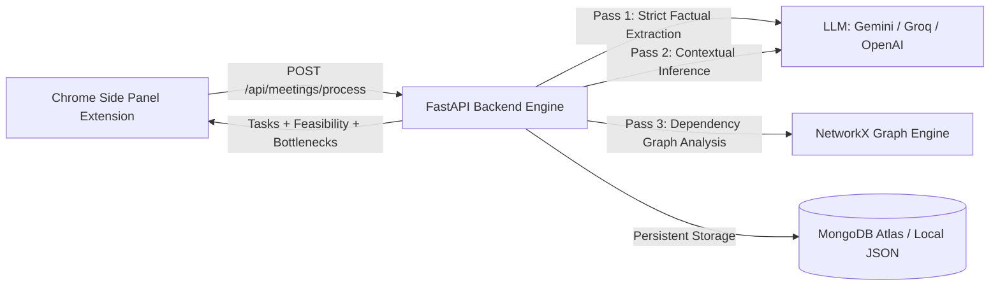

# Meeting Minutes & Task Intelligence System

An end-to-end meeting intelligence pipeline that captures live meeting transcripts from a Chrome Extension, extracts factual tasks using LLMs, infers contextual deadlines and dependencies, validates schedule feasibility, and identifies blockers and bottlenecks using graph algorithms.

---

## Architecture Overview



1. **Frontend (Browser Extension)**:
   - Manifest V3 Side Panel extension (`Extension/`).
   - Captures speech in real-time with timestamps.
   - Sends structured meeting payload to `http://127.0.0.1:8000/api/meetings/process`.
   - Displays extracted tasks, priorities, unassigned flags, deadlines, and schedule bottlenecks directly in the side panel.

2. **Backend (`task-backend/`)**:
   - **FastAPI** with CORS enabled for extension and web frontends.
   - **Pass 1 (`/api/v1/extract-factual`)**: Strict factual extraction (only tasks explicitly spoken aloud).
   - **Pass 2 (`/api/v1/infer-context/{meeting_id}`)**: AI Project Manager inference (priorities, missing owners, deadlines, inferred dependencies, external blockers).
   - **Graph Engine (`graph_engine.py`)**: Uses NetworkX to build a directed acyclic graph (DAG), detecting circular dependency deadlocks and surfacing schedule bottlenecks.
   - **Storage**: Persists to MongoDB Atlas when configured, with automatic fallback to local JSON storage (`storage/meetings_store.json`).

---

## Quickstart

### 1. Environment Setup

Create `.env` in the project root or `task-backend/` (or copy from `.env.example`):

```env
# LLM Providers (Configure at least one)
GEMINI_API_KEY=your_gemini_key_here
GROQ_API_KEY=your_groq_key_here
OPENAI_API_KEY=your_openai_key_here

# MongoDB Atlas URL (leave blank for automatic local storage fallback)
MONGODB_URL=

# Server Configuration
HOST=127.0.0.1
PORT=8000
```

### 2. Start the Backend

From the project root:

```bash
# Using the local virtual environment
.venv\Scripts\python task-backend\main.py
```

Or using `uvicorn`:

```bash
cd task-backend
..\.venv\Scripts\uvicorn main:app --reload --host 127.0.0.1 --port 8000
```

Verify backend health at: [http://127.0.0.1:8000/health](http://127.0.0.1:8000/health)

### 3. Load the Chrome Extension

1. Open Chrome or Edge and navigate to `chrome://extensions`.
2. Enable **Developer mode** (toggle in upper right).
3. Click **Load unpacked** and select the `Extension` directory.
4. Click the extension icon in your browser toolbar to open the side panel.
5. Enter a title and participants, click **Start meeting**, and speak into your microphone.
6. Click **Process with Backend** to extract tasks and analyze the dependency graph!

----

## API Endpoints

| Method | Endpoint | Description |
|---|---|---|
| `GET` | `/health` | Healthcheck and active provider status |
| `POST` | `/api/meetings/process` | End-to-end meeting processing (consumed by extension) |
| `POST` | `/api/v1/extract-factual` | Pass 1: Strict factual task extraction |
| `POST` | `/api/v1/infer-context/{id}` | Pass 2: Contextual enrichment & graph analysis |
| `GET` | `/api/meetings` | List all processed meetings |
| `GET` | `/api/meetings/{id}` | Retrieve meeting document and graph analysis |

